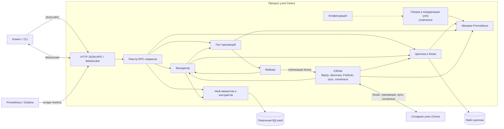
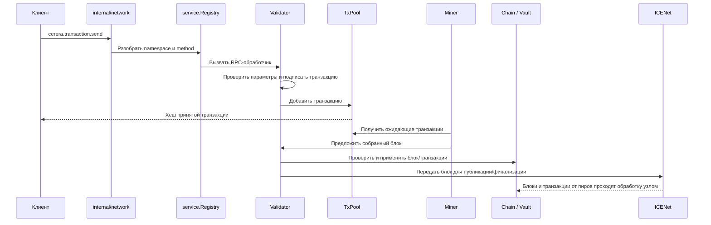

# Архитектура Cerera

Документ описывает архитектуру узла Cerera по текущей структуре исходного кода. Основная точка сборки приложения — `cmd/cerera`; конфигурация узла загружается из `config`, а компоненты связываются в `internal/node`.

## Контекст системы

Узел Cerera — самостоятельный процесс блокчейна. Внешние клиенты обращаются к нему через HTTP JSON-RPC и WebSocket, соседние узлы обмениваются блоками, транзакциями и сообщениями консенсуса через ICENet. Данные цепочки и локального vault хранятся отдельно.

## Компоненты и исходный код

| Компонент | Пакеты | Ответственность |
|---|---|---|
| Запуск и композиция | `cmd/cerera`, `internal/node` | CLI и wiring узла: registry, RPC-адаптеры, ICENet service provider, майнер. |
| RPC-адаптеры | `internal/rpc` | JSON-RPC handlers для chain, vault, pool (Anti-Corruption Layer над `core`). |
| Доменные параметры | `core/params` | Экономика сети: эмиссия, halving, лимиты faucet. |
| События узла | `core/events` | Типы событий и интерфейс `Publisher` для chain, pool, vault, ICENet. |
| Порты ICENet | `core/ports` | Интерфейсы `ChainLedger` / `VaultStore` для sync и consensus. |
| Подписчики узла | `internal/observer` | Синхронная шина событий: validator, miner, ICENet metrics/gossip. |
| Конфигурация | `config` | Параметры цепочки, сети, пула, хранения и HTTP/TLS. |
| HTTP API | `internal/network` | JSON-RPC, WebSocket, `/metrics`; вызывает `service.Registry` (внешняя граница RPC). |
| Реестр сервисов | `internal/service` | Разбор `cerera.<service>.<method>` и dispatch только для HTTP/WebSocket клиентов. |
| Блокчейн | `core/block`, `core/chain`, `core/types` | Модели блоков и транзакций, состояние и управление цепочкой, базовые типы. |
| Проверка и исполнение | `internal/validator`, `internal/validation` | Проверяет транзакции и блоки, исполняет транзакции и связывает обновления состояния с цепочкой. |
| Пул | `core/pool` | Принимает проверяемые транзакции и предоставляет ожидающие транзакции майнеру. |
| Хранение | `core/storage`, `core/backup`, `vault/` | Vault аккаунтов и состояния контрактов, таблица транзакций, снимки/резервное копирование; цепочка хранится через файловый backend. Режим хранения задаётся конфигурацией. |
| P2P и синхронизация | `icenet` | libp2p host, discovery/DHT, пиры, PubSub, протокол блоков, синхронизация цепочки, обработка форков и консенсус. |
| Майнинг | `miner` | Собирает блок из пула, ищет proof-of-work и передаёт блок на проверку/публикацию. |
| VM контрактов | `pallada` | Стековая виртуальная машина и выполнение контрактного кода. |
| Метрики и мониторинг | `icenet/metrics`, метрики в `core/chain`, `core/pool`, `miner`; `deployments/`, `grafana/` | Экспорт метрик Prometheus и конфигурации мониторинга. |

## Жизненный цикл узла

`cmd/cerera/main.go` выполняет композицию зависимостей примерно в таком порядке:

1. Загружает конфигурацию, настраивает журналирование и контекст остановки.
2. Создаёт `observer.Bus` и `internal/service.Registry`, помещает registry в контекст.
3. Инициализирует `gigea`, vault и chain; регистрирует RPC через `internal/rpc` в registry.
4. Создаёт валидатор и pool; регистрирует validator RPC; запускает HTTP.
5. Запускает `icenet.Start` (транспорт без service provider).
6. Создаёт `icenet/service.ServiceProvider` с портами `core/ports` (chain + vault + block validator) и вызывает `ice.SetServiceProvider` (sync, consensus, protocol).
7. Связывает mempool, fork detector, майнер и callbacks финализации.

После успешной инициализации `main` блокируется на `<-ctx.Done()` (SIGINT/SIGTERM). HTTP-сервер завершается по отмене того же контекста. Затем вызывается `node.Shutdown`: майнер → pool → ICENet → vault.

Майнер может быть отключён флагом `-miner=false`; HTTP/TLS, порт P2P и каталог данных задаются параметрами запуска и конфигурацией.

## Основные потоки данных

### RPC-транзакция

Подробный разбор пользовательского пути `cerera.transaction.send` находится в [transaction_flow.md](transaction_flow.md). Точные названия RPC-методов и их параметры см. в [API.md](../API.md).

### P2P и состояние цепочки

ICENet предоставляет транспорт и сетевые сервисы. `protocol`, `sync`, `consensus` и `fork` используют `icenet/service.ServiceProvider` — фасад над `core/ports`, без in-process вызовов через `service.Registry`.

## Границы и направления связей

- `internal/node` — composition root: registry, `internal/rpc`, ICENet service provider, майнер.
- `core` не импортирует `internal/service`, `internal/coinbase`, `internal/observer` (CI: `go run ./scripts/check_core_imports.go`).
- `internal/network` и `internal/rpc` — driving adapters; `service.Registry` только для внешних JSON-RPC клиентов.
- `icenet/service.ServiceProvider` зависит от `core/ports`, не от registry.
- Доменные события (`core/events`) публикуются из chain/pool/vault/consensus/sync; подписчики регистрируются на `observer.Bus` в `internal/node`.
- `miner` зависит от интерфейсов пула, цепочки и валидатора и публикует подготовленные блоки через ICENet.
- `pallada` — отдельный пакет VM; выполнение контрактного кода вызывается из логики исполнения транзакций.

## Реализация и текущие ограничения

- В `internal/node` вызывается `gigea.Init`; консенсус создаётся при `ice.SetServiceProvider`.
- Miner и validator подписаны на [`internal/observer`](internal/observer) Bus (`ChainReorged`, `ChainHeadUpdated`, `TxAccepted`, `AccountCreated`); HTTP RPC registry и bus — разные границы.
- `internal/mesh` содержит отдельную сетевую реализацию; основная точка запуска узла использует `icenet.Start` и libp2p.
- Локальный vault и данные цепочки — отдельные хранилища. Конкретные пути и режим памяти определяются конфигурацией и параметрами запуска.

## Развёртывание

Docker Compose-файлы и конфигурации мониторинга находятся в `deployments/` и `grafana/`. Узел предоставляет HTTP API, WebSocket и Prometheus endpoint; P2P-порт используется для связи узлов. Состав сервисов и сетевые порты конкретного стенда задаются соответствующим compose-файлом.
