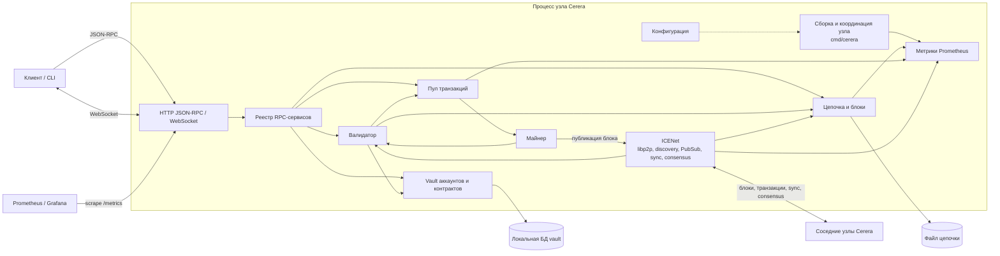
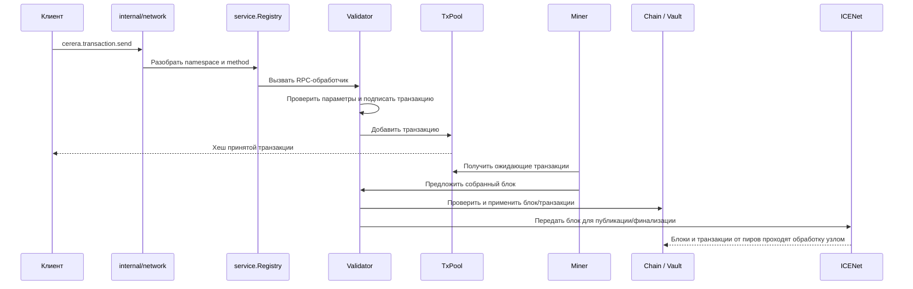

# Архитектура Cerera

Документ описывает архитектуру узла Cerera по текущей структуре исходного кода. Основная точка сборки приложения — `cmd/cerera`; конфигурация узла загружается из `config`, а компоненты связываются в `NewCerera`.

## Контекст системы

Узел Cerera — самостоятельный процесс блокчейна. Внешние клиенты обращаются к нему через HTTP JSON-RPC и WebSocket, соседние узлы обмениваются блоками, транзакциями и сообщениями консенсуса через ICENet. Данные цепочки и локального vault хранятся отдельно.

## Компоненты и исходный код

| Компонент | Пакеты | Ответственность |
|---|---|---|
| Запуск и композиция | `cmd/cerera` | Читает флаги и конфигурацию, создаёт компоненты и задаёт связи между ними. `cmd/cereractl` — клиентская CLI-утилита. |
| Конфигурация | `config` | Параметры цепочки, сети, пула, хранения и HTTP/TLS. |
| HTTP API | `internal/network` | JSON-RPC, WebSocket, `/metrics`; направляет RPC-вызов к зарегистрированному обработчику. |
| Реестр сервисов | `internal/service` | Разбирает имя метода `cerera.<service>.<method>` и находит обработчик. |
| Блокчейн | `core/block`, `core/chain`, `core/types` | Модели блоков и транзакций, состояние и управление цепочкой, базовые типы. |
| Проверка и исполнение | `internal/validator`, `internal/validation` | Проверяет транзакции и блоки, исполняет транзакции и связывает обновления состояния с цепочкой. |
| Пул | `core/pool` | Принимает проверяемые транзакции и предоставляет ожидающие транзакции майнеру. |
| Хранение | `core/storage`, `core/backup`, `vault/` | Vault аккаунтов и состояния контрактов, таблица транзакций, снимки/резервное копирование; цепочка хранится через файловый backend. Режим хранения задаётся конфигурацией. |
| P2P и синхронизация | `icenet` | libp2p host, discovery/DHT, пиры, PubSub, протокол блоков, синхронизация цепочки, обработка форков и консенсус. |
| Майнинг | `miner` | Собирает блок из пула, ищет proof-of-work и передаёт блок на проверку/публикацию. |
| VM контрактов | `pallada` | Стековая виртуальная машина и выполнение контрактного кода. |
| Метрики и мониторинг | `icenet/metrics`, метрики в `core/chain`, `core/pool`, `miner`; `deployments/`, `grafana/` | Экспорт метрик Prometheus и конфигурации мониторинга. |

## Жизненный цикл узла

`cmd/cerera/main.go` выполняет композицию зависимостей примерно в таком порядке:

1. Загружает конфигурацию, настраивает журналирование и контекст остановки.
2. Создаёт `internal/service.Registry` и помещает его в контекст.
3. Инициализирует `gigea`, локальный vault и цепочку; регистрирует доступные RPC-методы.
4. Создаёт валидатор и пул транзакций и регистрирует их методы.
5. Запускает HTTP API.
6. Запускает `icenet.Ice`, затем связывает валидатор, пул, цепочку, vault, майнер и сетевую публикацию.
7. Настраивает обработчик реорганизации цепочки и обратные вызовы финализации блока.
8. Запускает майнинг, если он включён.

После успешной инициализации `main` блокируется на `<-ctx.Done()` (SIGINT/SIGTERM). HTTP-сервер завершается по отмене того же контекста. Затем вызывается `Cerera.Shutdown`: майнер → пул → ICENet → vault.

Майнер может быть отключён флагом `-miner=false`; HTTP/TLS, порт P2P и каталог данных задаются параметрами запуска и конфигурацией.

## Основные потоки данных

### RPC-транзакция

Подробный разбор пользовательского пути `cerera.transaction.send` находится в [transaction_flow.md](transaction_flow.md). Точные названия RPC-методов и их параметры см. в [API.md](../API.md).

### P2P и состояние цепочки

ICENet предоставляет транспорт и сетевые сервисы. `protocol` обрабатывает сообщения и протокол блоков, `sync` синхронизирует цепочку, `consensus` координирует финализацию, `fork` обнаруживает расхождения, а `peers` управляет участниками и их оценкой. Через service provider сетевой слой получает доступ к цепочке и другим функциям узла. Проверка и применение полученных данных остаются частью логики узла и валидатора.

## Границы и направления связей

- `cmd/cerera` — composition root: прикладные пакеты связываются здесь через интерфейсы и setter-методы.
- `core` содержит доменные типы, цепочку, пул и хранилище; сетевой транспорт вынесен в `icenet`.
- `internal/network` отвечает за внешний API, а `internal/service` — за маршрутизацию RPC к обработчикам доменных компонентов.
- `miner` зависит от интерфейсов пула, цепочки и валидатора и публикует подготовленные блоки через ICENet.
- `pallada` — отдельный пакет VM; выполнение контрактного кода вызывается из логики исполнения транзакций.

## Реализация и текущие ограничения

- В `NewCerera` вызывается `gigea.Init`, однако создание `gigea.ConsensusManager` через `icenet.NetworkAdapter` оставлено закомментированным. Текущий сетевой менеджер консенсуса создаётся внутри ICENet при настройке service provider.
- Внутренний event pipeline для обработки стадий между сервисами не реализован; при необходимости его можно добавить отдельно.
- `internal/mesh` содержит отдельную сетевую реализацию; основная точка запуска узла использует `icenet.Start` и libp2p.
- Локальный vault и данные цепочки — отдельные хранилища. Конкретные пути и режим памяти определяются конфигурацией и параметрами запуска.

## Развёртывание

Docker Compose-файлы и конфигурации мониторинга находятся в `deployments/` и `grafana/`. Узел предоставляет HTTP API, WebSocket и Prometheus endpoint; P2P-порт используется для связи узлов. Состав сервисов и сетевые порты конкретного стенда задаются соответствующим compose-файлом.
